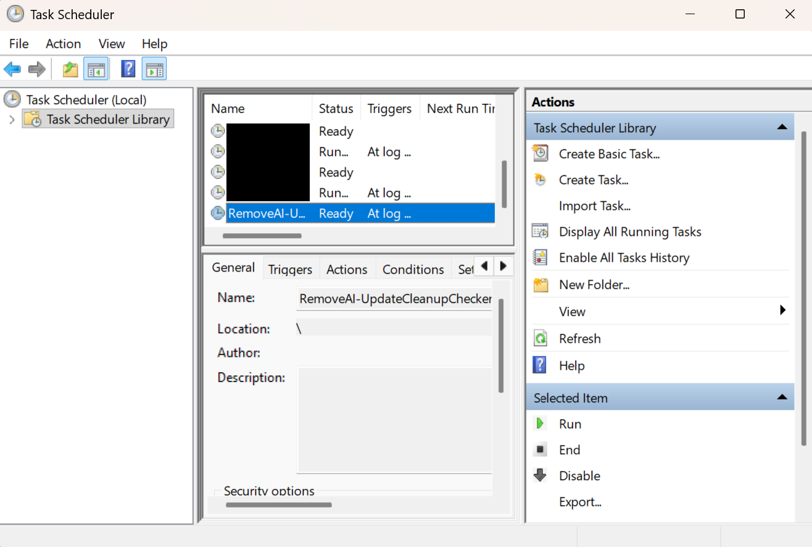
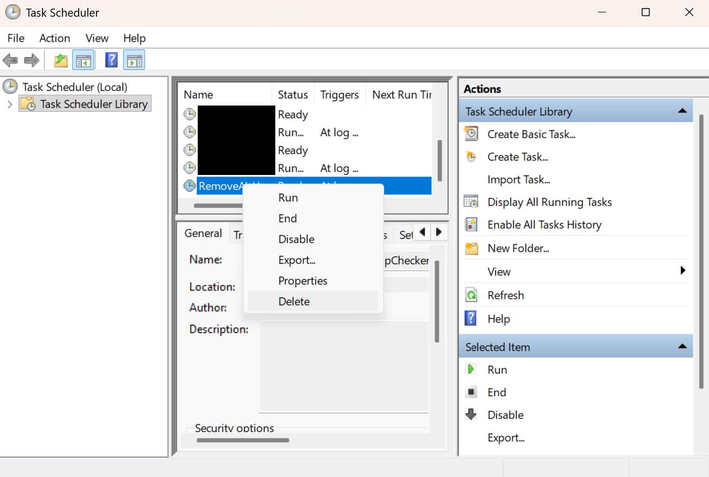
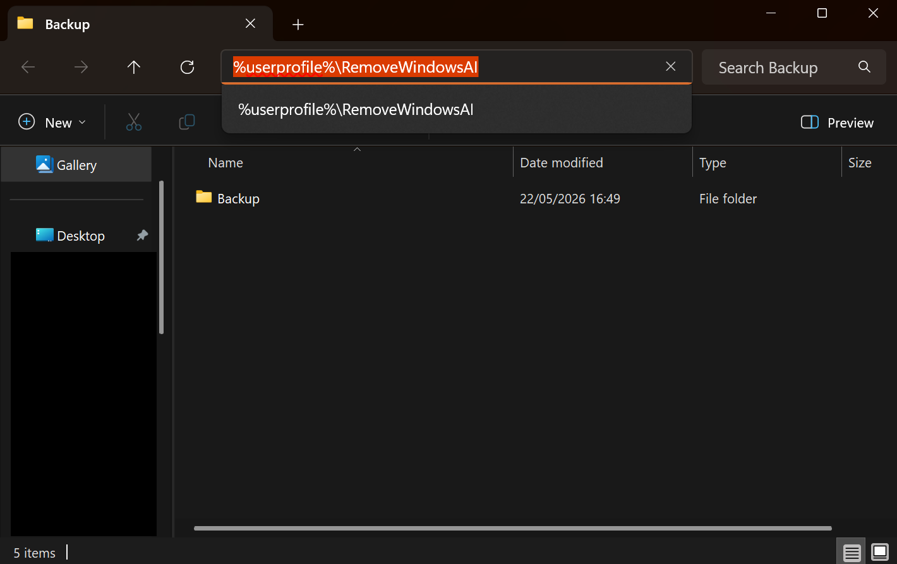
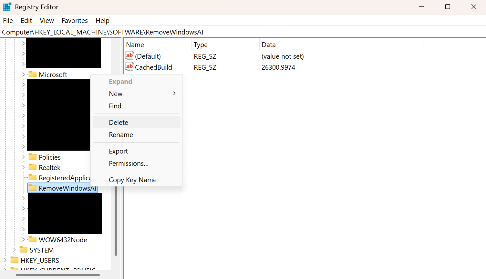

# RemoveWindowsAI uninstall guide

This guide is for anyone that used zoicware/RemoveWindowsAI.

Having installed it leaves behind some things.

# 1. Task (for uninstalling AI again after a Windows update)

Open task scheduler (type `taskschd.msc` in the start menu search field if you are unsure what to select).
Press `Task Scheduler Library`, and look for the `RemoveAI-UpdateCleanupChecker` task

Right click, and press delete

# 2. Remove left over installation files

Remove the script the task would call: `C:\ProgramData\RemoveAI-UpdateCleanup.ps1`

# 3. Undoing changes

As the script is now gone, to undo (some of) the changes, wait for a Windows update.

If you have checked the backup option when installing RemoveWindowsAI, there will be a folder containing some information about system configuration prior to running RemoveWindowsAI.

Type the following in Windows Explorer: `%userprofile%\RemoveWindowsAI`

This guide currently does not cover restoring anything from this backup specifically. The backup feature wasn't very stable. If anyone wishes to contribute anything from that, start a discussion.

# Unimported leftovers

A registry key is created for the Windows version that has been processed by the RemoveWindowsAI script. This can be removed using the registry editor (or type regedit.exe if you are unsure).

The path of the key is: `Computer\HKEY_LOCAL_MACHINE\SOFTWARE\RemoveWindowsAI`

To remove it, do the following:

